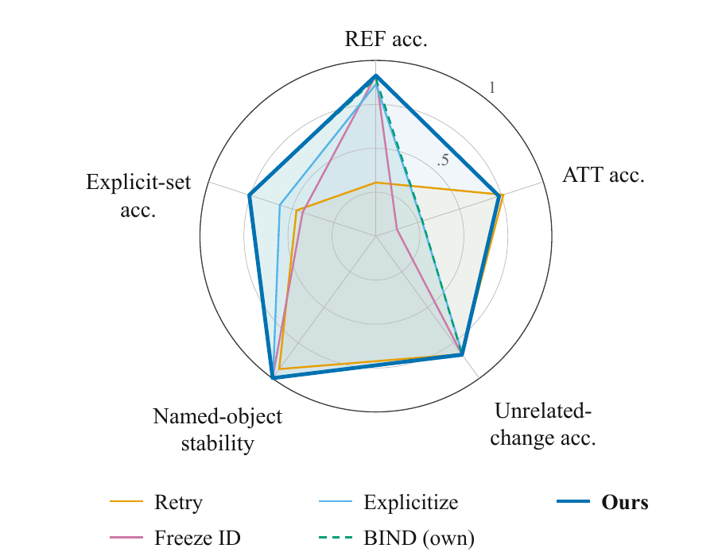

<div align="center">

# BIND

**Intent-aware retry for robots that share an object memory**

**English** | [简体中文](README.zh-CN.md)

</div>

When several robots read and write the same object memory, a write can be rejected because another robot
committed first. The usual fix is to retry the same instruction against the newest memory, but the scene may have
changed in between, and the retry can quietly pick a different object than the one the user meant.

BIND decides, before retrying, what the user actually meant:

- **referential** request (the user meant *that specific object*): keep the object chosen at read time;
- **attributive** request (the user meant *whichever object fits the description*): re-resolve on the current view;
- **unclear**: ask the user.

The repository also contains **EmbodiedDrift**, an AI2-THOR benchmark for measuring this retry-induced re-binding.

<p align="center"></p>

## How it works

<p align="center"></p>

1. At read time, a grounding VLM drafts the action on view *B* and stores the selected object id.
2. If the commit is rejected, a text-only intent reasoner reads the conversation and the shared notes
   (no images) and labels the request as referential, attributive or unclear.
3. The retry is routed: replay the read-time id, re-ground on the current view *C*, or ask.

## Results

<p align="center"></p>

<p align="center"></p>

On the memory-grounded benchmark split, averaged over five grounding VLMs, BIND reaches about 80–84% accuracy,
while the strongest retry baseline reaches 59–67%. Plain retry fails referential requests, and always
replaying the old id fails attributive ones; BIND handles both.

## Installation

```bash
git clone https://github.com/exsinger-hub/BIND.git
cd BIND
pip install "ai2thor>=5.0,<5.1" numpy pillow torch transformers vllm
```

- Python ≥ 3.10. AI2-THOR renders headless with `CloudRendering` on a GPU.
- 8–9B models run on one 24 GB GPU; 27–31B models need two 80 GB GPUs (`--tp 2`).

## Quick start

```bash
cd embodied

# 1. Render episodes from the stored metadata (images are not in the repo)
python gen_episodes.py --scenes FloorPlan1 FloorPlan2 --seeds 0 --out episodes

# 2. Grounding + retry with a VLM
python run_vlm.py --model <vlm_model_id> --tag myvlm --episodes episodes \
    --instr instr/grounded/instructions_grounded.jsonl --backend vllm --out res

# 3. Intent reasoner (structured prompt)
python mode_classify.py --model <llm_model_id> --tag myllm --structured \
    --instr instr/grounded/instructions_grounded.jsonl --phrases eps_json --out modes

# 4. Accuracy and failure breakdown
python diag.py --files res/both/*.jsonl --instr instr/grounded/instructions_grounded.jsonl \
    --intent modes/myllm_grounded_struct.jsonl --label grounded --json report.json
```

Useful options of `mode_classify.py`: `--think` (model thinking), `--ask` (allow an "unclear" answer),
`--n 5 --temperature 0.7` (self-consistency votes), `--variant` (note ablations).

## Repository layout

| Path | Contents |
|---|---|
| `embodied/gen_episodes.py` | AI2-THOR episode generator (duplicate targets, before/after views, set-of-marks) |
| `embodied/eps_json/` | Metadata of 572 episodes |
| `embodied/instr/` | Instructions and memory notes: explicit set, memory-grounded set (REF / ATT / AMB), paraphrased notes, implicit-cue set |
| `embodied/run_vlm.py`, `run_vlm_x.py` | Grounding and retry runners (HF or vLLM backend) |
| `embodied/mode_classify.py` | Intent reasoner |
| `embodied/diag.py` | Exclusive failure taxonomy; shared data loader |
| `embodied/analyze_vlm.py`, `route_analysis.py`, `controls.py`, `nid_eval.py`, `note_cues.py`, `pm_eval.py`, `vn_eval.py` | Accuracy, routing policies, baselines and controls |
| `embodied/e2_summary.py`, `e8_summary.py` | Intent-module ablations; clarification trade-off |
| `embodied/fam.py`, `export_rates.py`, `review_stats.py` | Per-family results, CSV export, bootstrap intervals |
| `embodied/build_note_variants.py`, `ingest_grounded.py`, `train_intent.py` | Note variants, ingestion, optional distilled classifier |
| `embodied/*_SPEC.md`, `DESIGN.md` | Benchmark design and note-writing specifications |
| `run_pilot.py`, `analyze.py`, `validate.py` | Text-only pilot |

## Data and models

- Simulator: [AI2-THOR](https://github.com/allenai/ai2thor) 5.0, iTHOR FloorPlans. Images are regenerated with
  `gen_episodes.py`.
- Grounding VLMs used in our experiments: Qwen3-VL-8B, InternVL3.5-8B, Qwen3.6-27B, Gemma-4-31B.
  Intent reasoners: Qwen3.5-9B, Qwen3-8B, Qwen3-4B, Qwen3.5-4B, Llama-3.1-8B. Any Hugging Face checkpoint supported
  by `transformers` or `vllm` can be passed with `--model`.
- Instructions and notes were written by an LLM following `embodied/INSTR_SPEC.md` and
  `embodied/GROUNDED_SPEC.md`; target objects and labels come from simulator metadata.
- Model outputs and cached results are not included.
