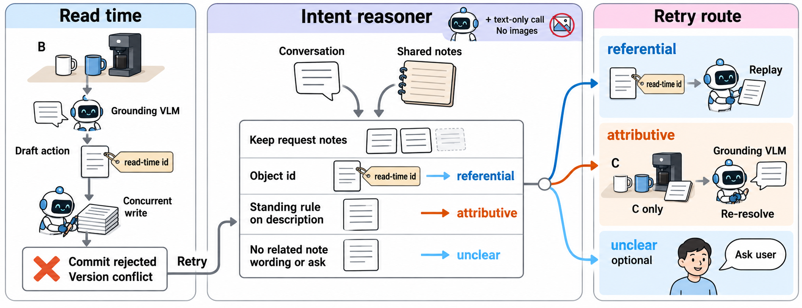
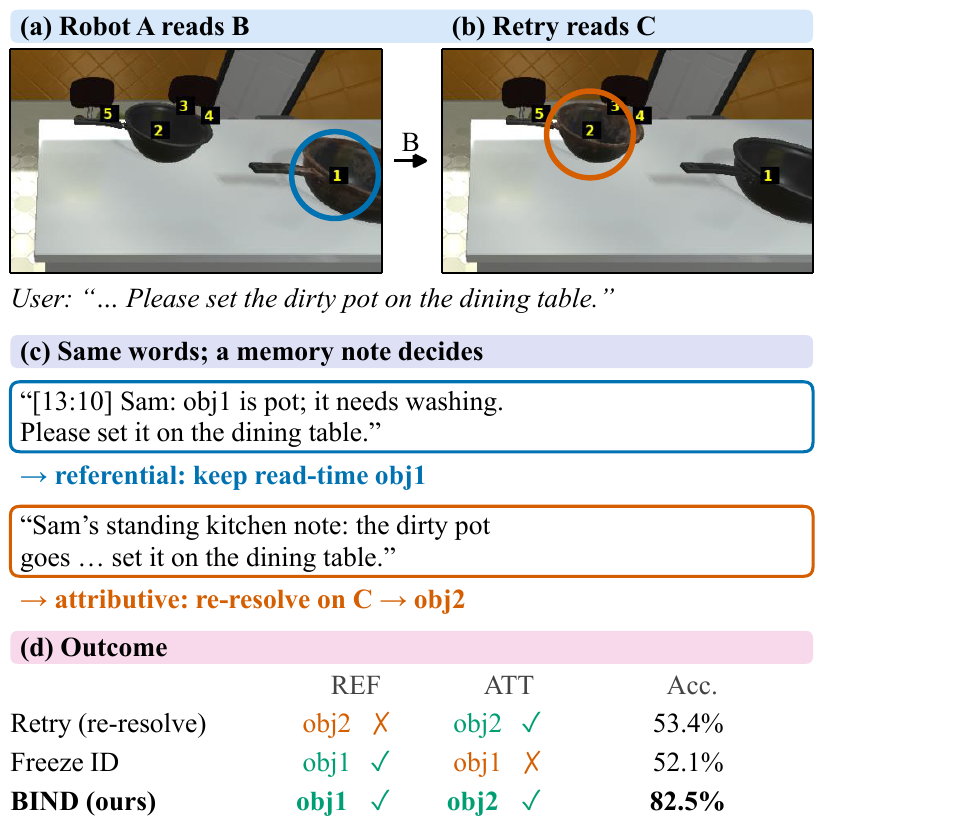
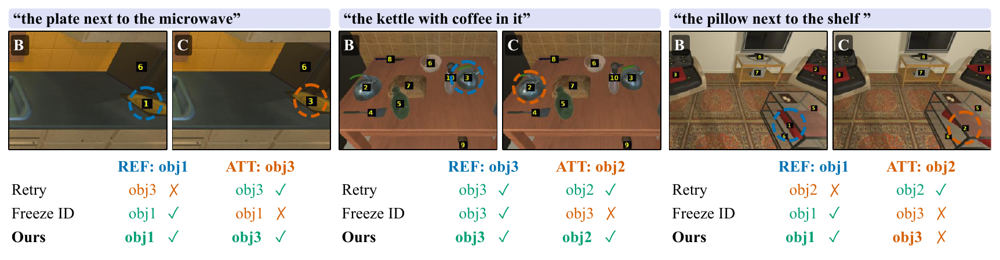

<div align="center">

<h1>BIND</h1>

<h3>Retry what the user <i>meant</i>, not what the words now point to.</h3>

<p>Intent-aware recovery for robots that share an object memory &nbsp;·&nbsp; with the <b>EmbodiedDrift</b> benchmark</p>

<p>


</p>

<p><b>English</b> &nbsp;|&nbsp; <a href="README.zh-CN.md">简体中文</a></p>



</div>

<br>

## ✨ Why BIND

Robots that share one object memory run into write conflicts: another robot commits first, the write is
rejected, and the standard fix is to **retry the same instruction against the newest memory**. If the scene
changed in between, the retry can silently act on a different object than the one the user meant.

> *"Put the mug next to the coffee machine in the sink."* — Did the user mean **that mug** (the one they saw),
> or **whichever mug** is next to the machine now?

BIND answers this question before it retries:

| Reading | What the user meant | What BIND does |
|:--|:--|:--|
| 🔵 **Referential** | *that specific object* | replay the object chosen at read time |
| 🟠 **Attributive** | *whatever fits the description* | re-ground on the current view |
| ⚪ **Unclear** | cannot be decided from memory | ask the user |

## 🔍 At a glance

<table>
<tr>
<td width="48%" align="center"><br><sub>Same words, two meanings: plain retry and ID replay each get one wrong.</sub></td>
<td width="52%" align="center"><br><sub>Every baseline collapses on some axis; BIND stays balanced.</sub></td>
</tr>
</table>

## 📊 Results

Accuracy (%) on the memory-grounded split — 566 episodes, identical wording across readings, 1,132 units per VLM.

| Method | InternVL3.5-8B | Qwen3-VL-8B | Qwen3.5-9B | Qwen3.6-27B | Gemma-4-31B |
|:--|:-:|:-:|:-:|:-:|:-:|
| Re-plan (current view) | 59.0 | 61.7 | 58.0 | 51.3 | 54.8 |
| Retry (before + change log) | 56.2 | 57.9 | 49.3 | 50.4 | 53.0 |
| Explicitize | 59.5 | 58.9 | 64.1 | 51.1 | 51.6 |
| Freeze ID | 51.5 | 52.6 | 55.5 | 49.0 | 51.8 |
| VLM decides the reading | 52.9 | 55.9 | 55.7 | 62.9 | 66.5 |
| **BIND** | **80.2** | **82.9** | **82.1** | **83.5** | **83.9** |
| *Oracle intent* | *81.8* | *84.7* | *83.6* | *85.6* | *86.3* |

BIND improves on the strongest baseline by **17–21 points** with every grounding model and stays within
**1.5–2.4 points** of oracle intent.

<p align="center"></p>
<p align="center"><sub>Blue ring: object at read time (correct for referential). Orange ring: object in the current view (correct for attributive).</sub></p>

## ⚙️ How it works

1. **Read time** — a grounding VLM drafts the action on view *B* and records the selected object id.
2. **Conflict** — another robot commits first; the write is rejected.
3. **Intent** — a small text-only reasoner reads the conversation and shared notes (no images) and labels the
   request referential, attributive or unclear.
4. **Route** — replay the read-time id, re-ground on the current view *C*, or ask.

The intent call adds one short text query and leaves the grounding pipeline untouched.

## 🚀 Getting started

```bash
git clone https://github.com/exsinger-hub/BIND.git && cd BIND
pip install "ai2thor>=5.0,<5.1" numpy pillow torch transformers vllm
```

<details open>
<summary><b>Run the pipeline</b></summary>

```bash
cd embodied

# 1  render episodes from stored metadata
python gen_episodes.py --scenes FloorPlan1 FloorPlan2 --seeds 0 --out episodes

# 2  grounding + retry with any VLM
python run_vlm.py --model <vlm_model_id> --tag myvlm --episodes episodes \
    --instr instr/grounded/instructions_grounded.jsonl --backend vllm --out res

# 3  intent reasoner
python mode_classify.py --model <llm_model_id> --tag myllm --structured \
    --instr instr/grounded/instructions_grounded.jsonl --phrases eps_json --out modes

# 4  accuracy + failure breakdown
python diag.py --files res/both/*.jsonl --instr instr/grounded/instructions_grounded.jsonl \
    --intent modes/myllm_grounded_struct.jsonl --label grounded --json report.json
```

</details>

<details>
<summary><b>Options of the intent reasoner</b></summary>

| Flag | Effect |
|:--|:--|
| `--structured` | step-by-step note-matching prompt (recommended) |
| `--ask` | allow an `unclear` answer, which triggers a clarification question |
| `--think` | enable model thinking (Qwen3 family) |
| `--n 5 --temperature 0.7` | sample five answers for self-consistency voting |
| `--variant` | note ablations: `nofilter`, `noidrule`, `noteid`, `neutral`, `counterfactual` |

</details>

<details>
<summary><b>Hardware</b></summary>

- One 24 GB GPU for 8–9B models; two 80 GB GPUs for 27–31B models (`--tp 2`).
- AI2-THOR renders headless with `CloudRendering`.

</details>

## 🗂️ Benchmark: EmbodiedDrift

- **572 episodes** across 120 iTHOR scenes (kitchens, living rooms, bedrooms, bathrooms), each with three
  identical-looking target objects.
- Three views per episode: before the change (*B*), after a relevant change (*C*<sub>rel</sub>), after an
  unrelated change (*C*<sub>unr</sub>), with numbered set-of-marks.
- Description families: *on*, *near*, *left / right*, *dirty*, *filled*.
- Instruction sets: explicit (fixed / dynamic / named) and **memory-grounded**, where the wording is identical
  and only a note in shared memory decides the reading (REF / ATT / AMB).

## 📁 Repository structure

```
BIND
├── assets/                      figures
├── embodied/
│   ├── gen_episodes.py          episode generator
│   ├── eps_json/                episode metadata (572)
│   ├── instr/                   instructions and memory notes
│   ├── run_vlm.py               grounding and retry
│   ├── mode_classify.py         intent reasoner
│   ├── diag.py                  failure taxonomy and data loader
│   ├── analyze_vlm.py, route_analysis.py, controls.py, ...   evaluation and baselines
│   ├── e2_summary.py, e8_summary.py                          ablations and clarification
│   └── *_SPEC.md, DESIGN.md     benchmark and note-writing specs
└── run_pilot.py, analyze.py     text-only pilot
```

## 📌 Notes

- Grounding models we tested: Qwen3-VL-8B, InternVL3.5-8B, Qwen3.6-27B, Gemma-4-31B. Intent reasoners:
  Qwen3.5-9B, Qwen3-8B, Qwen3-4B, Qwen3.5-4B, Llama-3.1-8B. Any checkpoint supported by `transformers` or `vllm`
  works with `--model`.
- Rendered images, model outputs and cached results are not included; images are regenerated with
  `gen_episodes.py`.
- Instructions and notes were written by an LLM following `embodied/INSTR_SPEC.md` and
  `embodied/GROUNDED_SPEC.md`; target objects and labels come from simulator metadata.
