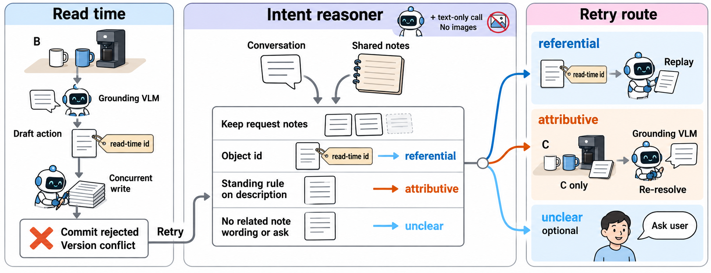
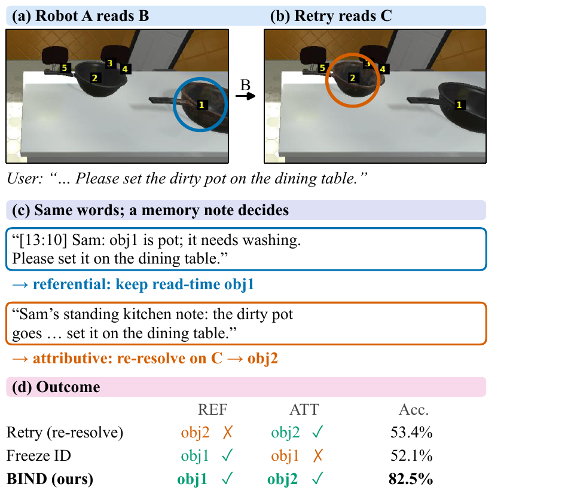
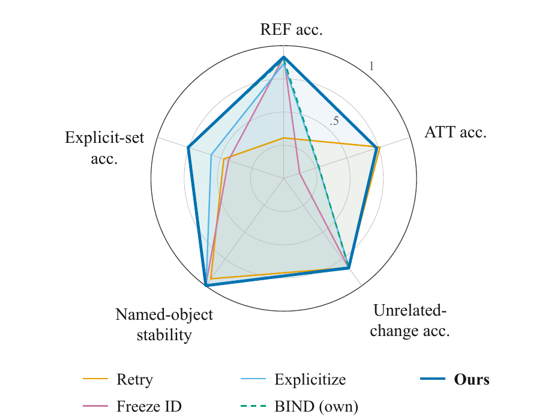
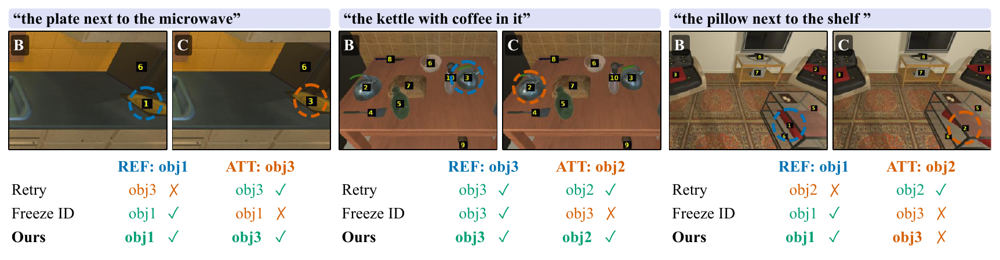

<div align="center">

<h1>BIND</h1>

<h3>重试用户<i>想要</i>的那个物体，而不是字面上现在指向的那个。</h3>

<p>面向共享物体记忆的多机器人意图感知恢复 &nbsp;·&nbsp; 附 <b>EmbodiedDrift</b> 基准</p>

<p>


</p>

<p><a href="README.md">English</a> &nbsp;|&nbsp; <b>简体中文</b></p>



</div>

<br>

## ✨ 为什么需要 BIND

多个机器人共用一份物体记忆时会发生写冲突：别的机器人先提交，自己的写入被拒绝。常规做法是**拿同一条指令对最新的
记忆重试**。如果这期间场景变了，重试可能悄悄作用到一个和用户本意不同的物体上。

> *"把咖啡机旁边的杯子放进水槽。"* —— 用户指的是**那个杯子**（他当时看到的那个），还是**现在**在咖啡机旁边的
> **任意一个杯子**？

BIND 在重试之前先回答这个问题：

| 读法 | 用户的意思 | BIND 的做法 |
|:--|:--|:--|
| 🔵 **指称性** | *就是那一个物体* | 沿用读取时选中的物体 |
| 🟠 **属性性** | *符合描述的那个* | 在当前视图上重新定位 |
| ⚪ **不确定** | 记忆里判断不了 | 向用户提问 |

## 🔍 一图看懂

<table>
<tr>
<td width="48%" align="center"><br><sub>同一句话两种意思：直接重试和沿用旧编号各错一种。</sub></td>
<td width="52%" align="center"><br><sub>每个基线都在某一维塌掉，BIND 各维都保持住。</sub></td>
</tr>
</table>

## 📊 结果

memory-grounded 划分上的准确率（%）：566 个场景，两种读法下措辞完全相同，每个视觉模型 1,132 个评测单元。

| 方法 | InternVL3.5-8B | Qwen3-VL-8B | Qwen3.5-9B | Qwen3.6-27B | Gemma-4-31B |
|:--|:-:|:-:|:-:|:-:|:-:|
| 重新规划（当前视图） | 59.0 | 61.7 | 58.0 | 51.3 | 54.8 |
| 重试（变化前视图 + 变更日志） | 56.2 | 57.9 | 49.3 | 50.4 | 53.0 |
| 显式化（Explicitize） | 59.5 | 58.9 | 64.1 | 51.1 | 51.6 |
| 固定编号（Freeze ID） | 51.5 | 52.6 | 55.5 | 49.0 | 51.8 |
| 由视觉模型自己判断读法 | 52.9 | 55.9 | 55.7 | 62.9 | 66.5 |
| **BIND** | **80.2** | **82.9** | **82.1** | **83.5** | **83.9** |
| *理想意图（oracle）* | *81.8* | *84.7* | *83.6* | *85.6* | *86.3* |

在每个视觉定位模型上，BIND 都比最强基线高 **17–21 个百分点**，与理想意图只差 **1.5–2.4 个百分点**。

<p align="center"></p>
<p align="center"><sub>蓝圈：读取时的物体（指称性读法下正确）；橙圈：当前视图中的物体（属性性读法下正确）。</sub></p>

## ⚙️ 工作原理

1. **读取时**：视觉定位模型在视图 *B* 上生成动作草稿，并记下选中的物体编号。
2. **冲突**：别的机器人先提交，写入被拒绝。
3. **判断意图**：一个只看文本的小模型读取对话和共享笔记（不看图像），把请求判为指称性、属性性或不确定。
4. **路由**：沿用读取时的编号、在当前视图 *C* 上重新定位，或者提问。

意图判断只多一次简短的文本调用，定位流程本身不用改。

## 🚀 快速开始

```bash
git clone https://github.com/exsinger-hub/BIND.git && cd BIND
pip install "ai2thor>=5.0,<5.1" numpy pillow torch transformers vllm
```

<details open>
<summary><b>运行流程</b></summary>

```bash
cd embodied

# 1  根据保存的元数据渲染场景
python gen_episodes.py --scenes FloorPlan1 FloorPlan2 --seeds 0 --out episodes

# 2  用任意视觉模型做定位与重试
python run_vlm.py --model <vlm_model_id> --tag myvlm --episodes episodes \
    --instr instr/grounded/instructions_grounded.jsonl --backend vllm --out res

# 3  意图推理
python mode_classify.py --model <llm_model_id> --tag myllm --structured \
    --instr instr/grounded/instructions_grounded.jsonl --phrases eps_json --out modes

# 4  准确率与错误分类
python diag.py --files res/both/*.jsonl --instr instr/grounded/instructions_grounded.jsonl \
    --intent modes/myllm_grounded_struct.jsonl --label grounded --json report.json
```

</details>

<details>
<summary><b>意图推理器的选项</b></summary>

| 参数 | 作用 |
|:--|:--|
| `--structured` | 逐步匹配笔记的结构化提示（推荐） |
| `--ask` | 允许回答 `unclear`，触发向用户提问 |
| `--think` | 开启模型思考（Qwen3 系列） |
| `--n 5 --temperature 0.7` | 采样五次做投票 |
| `--variant` | 笔记消融：`nofilter`、`noidrule`、`noteid`、`neutral`、`counterfactual` |

</details>

<details>
<summary><b>硬件</b></summary>

- 8–9B 模型一张 24 GB 显卡；27–31B 模型两张 80 GB 显卡（`--tp 2`）。
- AI2-THOR 用 `CloudRendering` 无界面渲染。

</details>

## 🗂️ 基准：EmbodiedDrift

- **572 个场景**，来自 120 个 iTHOR 房间（厨房、客厅、卧室、浴室），每个场景有三个外观相同的目标物体。
- 每个场景三种视图：变化前（*B*）、相关变化后（*C*<sub>rel</sub>）、无关变化后（*C*<sub>unr</sub>），带编号标记。
- 描述类别：*on*、*near*、*left / right*、*dirty*、*filled*。
- 指令集：显式集（fixed / dynamic / named）和 **memory-grounded** 集：措辞完全相同，只靠共享记忆里的一条笔记
  决定读法（REF / ATT / AMB）。

## 📁 目录结构

```
BIND
├── assets/                      图片
├── embodied/
│   ├── gen_episodes.py          场景生成
│   ├── eps_json/                场景元数据（572 个）
│   ├── instr/                   指令与记忆笔记
│   ├── run_vlm.py               定位与重试
│   ├── mode_classify.py         意图推理器
│   ├── diag.py                  错误分类与数据读取
│   ├── analyze_vlm.py, route_analysis.py, controls.py, ...   评测与基线
│   ├── e2_summary.py, e8_summary.py                          消融与澄清提问
│   └── *_SPEC.md, DESIGN.md     基准与笔记撰写规范
└── run_pilot.py, analyze.py     纯文本试点
```

## 📌 说明

- 测试过的视觉定位模型：Qwen3-VL-8B、InternVL3.5-8B、Qwen3.6-27B、Gemma-4-31B；意图推理器：Qwen3.5-9B、Qwen3-8B、
  Qwen3-4B、Qwen3.5-4B、Llama-3.1-8B。`--model` 可传入 `transformers` 或 `vllm` 支持的任意模型。
- 不包含渲染图像、模型输出和缓存结果；图像用 `gen_episodes.py` 重新生成。
- 指令和笔记由 LLM 按 `embodied/INSTR_SPEC.md`、`embodied/GROUNDED_SPEC.md` 撰写；目标物体和标签来自模拟器元数据。
